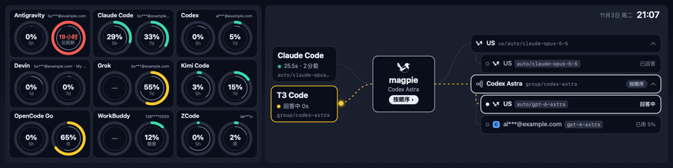
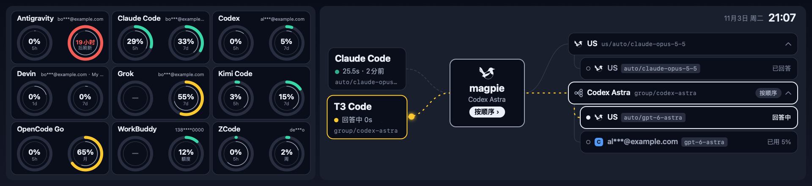
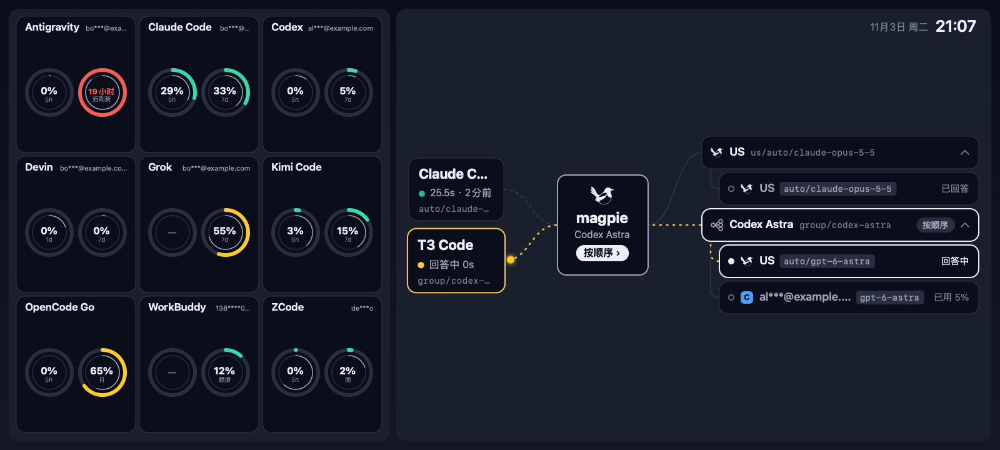
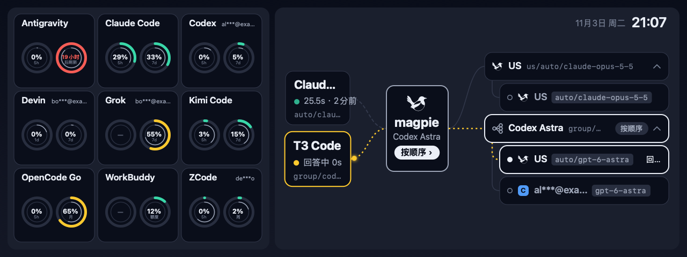

# MacTR — magpie Routing Dashboard for Thermalright LCD

[中文](README.md) · [English](README.en.md)

Turn the LCD on your Thermalright CPU cooler (1920×480 and other sizes) into a live dashboard for your
[magpie](https://usemagpie.ai) gateway: **how much of every subscription is left** on the
left, **how each request is being routed right now** on the right — all native on macOS,
no Windows required.


<sub>Running on a Thermalright Trofeo Vision 9.16 cooler (earlier UI).</sub>



<sub>Live demo (anonymized demo data). One card per subscription type on the left; on the
right a magpie carries a Claude Code request to the group's first member, flies back to
magpie on a 429 to have it handed on, and another magpie brings the answer home.</sub>

### Fits the screen

The frame size and whether it is turned 180° both come from the device's handshake, so
each screen is laid out for itself with nothing to configure. The same demo data on the
other sizes (rendered by `--snapshot --size`, the same renderer as the on-Mac preview):

**1920 × 440** (PM 69)



**1600 × 720** (FBL 114)



**1280 × 480** (PM 68)



> Fork of [beret21/MacTR](https://github.com/beret21/MacTR). Everything on screen comes from
> the gateway's `/v1/magpie/trace` and `/v1/magpie/quotas` endpoints.

## Highlights

### 🔀 Routing (right)
- **agent → magpie → routing-group members**, the same structure as magpie's own routing
  view; each recently active agent (Claude Code, T3 Code, Codex…) gets a node.
- **Magpies carry each request** (ported from magpie's own routing page) — one flies the
  request from the agent through magpie to the member routing picked and lets it go there,
  the dot resting at its card while it answers; another brings the answer (a ringed dot) back. On a
  failure the member shakes and wears a red tag (e.g. `429 · 限流`), and the magpie only
  flies back to magpie, which hands the request on to the next member.
- **Routing-group motion** — wires in the agent's colour, flowing while live; magpie's card
  swells and its logo flaps and flicks its tail as a request passes; member cards are one line each —
  account (masked), model and a short status (回答中 / 已回答 / used % / when it is back),
  white-edged when answering or answered, dashed while resting, dotted when set aside; the
  cards themselves carry no loading animation.
- **Every client animates at once**: each request under way (or whose magpies are still flying) is
  drawn together — its agent card lit and its wire flowing, a magpie in its colour flying its own
  group's way; the magpie card names the latest request's group.
- **Routing groups always drawn**: each recent agent's latest request is on the stage at once, each
  routing group under a heading row (name · model · routing) with its members hung below; only the
  focused request's group is lit. A request still being masked or routed stands on the group its
  model went to last. Members the group leaves out (switched off, used up and not to spend credits,
  at their cap) aren't shown; when rows overflow, account folds shut first, then other requests' groups.
- Members not tried show **used %**; three or more accounts of one provider and model fold
  under one heading; the hub shows the routing strategy
  (in order / direct …).
- The **time and date** sit in the top-right corner (e.g. `11月2日 周一 23:08`), and left of them the
  gateway's **usage today**: `今日 99.18M tokens · $113` (tokens = input + output + cache
  reads + cache writes; cost in USD, `+` when some requests had no price).
- A request not yet routed (magpie still masking it, or not done picking) holds the members' column
  with **placeholder rows** a light sweeps across, and a line saying why; one nothing took leaves
  them still, its reason in red.

### 📊 Subscription usage (left)
- **One card per subscription type** (Claude Code, Codex, Grok …); with several accounts
  of a type, only the one **in use right now** is shown — judged by last served time,
  usage seen rising, then 5-hour-window usage.
- **Two circles**: the short window (5 hours) on the left, the long one (7 days / month)
  on the right; a missing one shows as an empty ring.
- **Each circle is a pair of concentric rings**: usage outside (green → orange → red), and
  a thin line inside for how far the current period has run — outer ahead of inner
  means you're burning faster than the period.
- An account seen both locally and through a relay gateway is merged, keeping the healthy
  copy; accounts whose sign-in expired are listed last.

### 🔌 Switching gateways
- **Settings → magpie**: gateway address and API key, with **Test connection** before you
  save; the LCD switches within about a second.
- Defaults to the local gateway `http://127.0.0.1:3425` (no key needed). A remote
  gateway's key is sent as `Authorization: Bearer` and stored in the login Keychain.
- **Routing from a remote gateway needs its web key**: magpie answers 403 to the trace for
  any gateway key. Give the `magpie web` key instead (the `k=` in its sign-in link, i.e.
  `MAGPIE_WEB_KEY`) and MacTR signs in like the page does and reads `/api/gateway/trace` and
  `/api/usage/quotas`. The key type is detected; with a gateway key only usage is shown.
- The trace is fetched in full once, then incrementally via `?after=<seq>` — a few KB/s.

### ⚙️ Under the hood
- **Adaptive frame rate** — 20 fps while a magpie flies (a wing beat is 0.42 s), 10 fps
  while a request waits for its answer; otherwise the configured interval (2 fps by default).
- **CPU-frugal rendering** — the base layer (background, cards, text) is redrawn at most
  once a second and each frame only paints what moves; rotation and brightness use vImage
  (SIMD), and each frame goes out as a single USB transfer.
- **Fits the screen** — the frame size and whether it is turned 180° come from the
  device's handshake (1920×480, 1920×440, 1280×480, 1600×720…); nothing to set.
- **USB hotplug** — auto-reconnect on plug/unplug and sleep/wake.
- **On-Mac preview** — when no LCD is connected it renders to a window instead, so you can
  develop and see changes without the hardware.
- **Menu bar app** — runs in the background, no dock icon.

## Hardware

| | |
|---|---|
| **Product** | [Thermalright Trofeo Vision 9.16 LCD](https://www.thermalright.com/product/trofeo-vision-9-16-lcd-black/) |
| **Display** | 9.16" IPS, 1920 × 480 |
| **Connection** | USB Type-C (USB 2.0) |
| **Device** | `0416:5408` (LY Bulk protocol) |
| **Max frame rate** | ~26 fps on the newer revision, ~19 fps on the original (`--benchmark --static`) |

## Requirements

- Apple Silicon Mac (M1–M5)
- macOS 15 (Sequoia) or newer

That's the whole list if you install the release build — libusb ships inside the app,
so Homebrew is not needed. `libusb` and a Swift 6.1+ toolchain are only required to
build from source.

## Install

Grab the `.dmg` from
[Releases](https://github.com/m1ng-li/mac-thermalright-ai-monitor/releases),
open it and drag **MacTR AI** into Applications.

> **Gatekeeper will block the first launch.** The app is ad-hoc signed only — there is
> no $99/year Apple Developer certificate behind it — so macOS reports an unverified
> developer. In Applications, **right-click the icon → Open**, then click Open again in
> the dialog. Once is enough.
>
> The command-line equivalent:
>
> ```bash
> xattr -dr com.apple.quarantine "/Applications/MacTR AI.app"
> ```

Once installed, open Settings from the menu bar icon to enable launch at login.

## Build from source

```bash
brew install libusb pkg-config

git clone https://github.com/m1ng-li/mac-thermalright-ai-monitor.git
cd mac-thermalright-ai-monitor
swift build -c release

.build/release/MacTR          # menu-bar app; drives the LCD, or previews in a window
```

> If your Command Line Tools are broken and `swift build` fails on the package manifest,
> install the Homebrew Swift toolchain (`brew install swift`) and use
> `/opt/homebrew/opt/swift/bin/swift build -c release`, or pass
> `SWIFT=/opt/homebrew/opt/swift/bin/swift` to the packaging scripts below.

### Packaging it yourself

```bash
./packaging/build-app.sh      # → dist/MacTR AI.app (bundles libusb, ad-hoc signed)
./packaging/make-dmg.sh       # → dist/MacTR-AI-<version>-arm64.dmg
```

`build-app.sh` copies every non-system dylib the binary references into
`Contents/Frameworks`, rewrites the install names, and then asserts that no
build-machine paths survived into the bundle.

The git tag is the source of truth for the version: pushing a `v*` tag triggers the
[release workflow](.github/workflows/release.yml), which builds on CI and uploads the
DMG to a GitHub Release.

### Auto-start on login

Use the toggle in the app's Settings (backed by `SMAppService`).

If you also want the app relaunched after a crash, use the LaunchAgent instead:

```bash
cp packaging/com.m1ngli.MacTRAI.plist ~/Library/LaunchAgents/
launchctl load -w ~/Library/LaunchAgents/com.m1ngli.MacTRAI.plist
```

Pick one or the other — enabling both starts two instances that fight over the USB device.

## Modes

```bash
.build/release/MacTR                 # menu-bar app (LCD, or preview window if no LCD)
.build/release/MacTR --preview       # force the on-Mac preview window
.build/release/MacTR --snapshot x.png              # render one frame to a PNG
.build/release/MacTR --snapshot x.jpg              # the JPEG the LCD receives (turned 180°); --no-rotate for upright
.build/release/MacTR --snapshot x.png --size 1280x480   # draw for another screen size
.build/release/MacTR --gif x.gif --frames 40 --fps 10 --scale 2   # animated demo GIF
.build/release/MacTR --benchmark 120 [--static]    # LCD frame rate (--static: device + USB only)
.build/release/MacTR --pipeline-bench              # CPU cost of render + encode per frame
# Frames are JPEG-encoded on Apple silicon's hardware by default (Settings → Display → Encoding);
# add --sw-jpeg / --hw-jpeg to any of these to pick the encoder for one run
.build/release/MacTR --cli                         # drive the LCD headless
```

For an installed copy the same entry point is
`/Applications/MacTR AI.app/Contents/MacOS/MacTR`.

Any mode can target a gateway for one run with `-magpieURL http://host:port`;
`-magpieURL file:///some/dir` reads canned `v1/magpie/trace` and `v1/magpie/quotas` files
from that directory instead (for demos and tests). The `MAGPIE_API_KEY` environment
variable sets the key for one run without touching the Keychain.

Only one process can hold the USB device at a time — stop the running instance before
using `--benchmark` / `--cli`.

## Data sources

| Endpoint | Used for |
|---|---|
| `GET /v1/magpie/trace` | recent requests: agent, routing group and strategy, member order, each attempt's status and timing |
| `GET /v1/magpie/quotas` | every subscription account's usage windows, used %, reset times |

The trace is polled every second (incrementally); quotas refresh every 30 seconds.

## Privacy

MacTR only reads from the magpie gateway you configure in Settings and talks to no other
network service. The API key lives in the login Keychain, never in the preferences file.
No telemetry.

## Credits

- [beret21/MacTR](https://github.com/beret21/MacTR) — the original macOS driver this is built on
- [thermalright-trcc-linux](https://github.com/Lexonight1/thermalright-trcc-linux) — LY Bulk protocol reverse engineering
- [magpie](https://usemagpie.ai) — the AI gateway that provides the routing and usage data

## License

MIT (inherited from the upstream project).

---

Built with Swift + libusb. Developed with [Claude Code](https://claude.com/claude-code).
