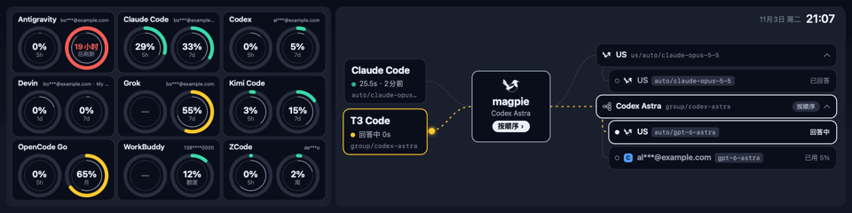

# MacTR —— 利民 LCD 上的 magpie 路由看板

[中文](README.md) · [English](README.en.md)

把利民 CPU 散热器上的 1920×480 LCD 变成 [magpie](https://usemagpie.ai) 网关的实时看板:
左边是**每个订阅账号还剩多少额度**,右边是**请求此刻怎么被路由**的动画 —— 全部原生运行于 macOS,无需 Windows。


<sub>装在利民 Trofeo Vision 9.16 散热器上的实拍效果(旧版界面)。</sub>



<sub>实时演示(脱敏的演示数据)。左边每类订阅一张卡片;右边一只喜鹊把 Claude Code 的请求叼到第一个成员,遇到 429 飞回 magpie 转给下一个,答案再由另一只喜鹊送回。</sub>

> 基于 [beret21/MacTR](https://github.com/beret21/MacTR) 改造,显示内容来自 magpie 网关的
> `/v1/magpie/trace` 与 `/v1/magpie/quotas` 接口。

## 亮点

### 🔀 路由(右)
- **agent → magpie → 路由组成员** 三栏,和 magpie 网页的路由视图同一套结构;最近活跃的 agent(Claude Code、T3 Code、Codex…)各占一个节点。
- **喜鹊送信动画**(照搬 magpie 网页的路由动画)—— 一只喜鹊叼着请求从 agent 出发、穿过 magpie,放到路由选中的成员上,成员回答时圆点停在它的卡片边;回答完另一只喜鹊把答案(描边圆点)送回 agent。失败时成员卡片抖动并挂出红色标签(如 `429 · 限流`),喜鹊只飞回 magpie,由它转给下一个成员。
- **路由组动效** —— 路径按 agent 的颜色绘制,在途时虚线流动;请求经过时 magpie 卡片轻微放大、logo 喜鹊扇翅摆尾;成员卡片单行显示:账号(脱敏)、模型与一句简短状态(回答中 / 已回答 / 已用 % / 额度用尽 · 16:00 恢复),正在回答或已回答的白边,休息中的虚线、暂不使用的点线;卡片本身不做加载动画。
- **多个 client 同时动画**:每个正在进行(或喜鹊还没飞完)的请求都同时画出:各自的 agent 卡片高亮、连线流动,各自颜色的喜鹊沿各自路由组飞行;中间 magpie 卡片显示最近一个请求的组。
- **路由组始终显示**:最近几个 agent 各自最新的请求同时上台,每个路由组一行标题(组名 · 模型 · 路由策略),成员挂在标题下;只高亮当前请求的那一组。请求还在脱敏 / 路由时沿用该模型上次路由到的组。已被组排除的账号(停用、额度用尽且不用积分、达到用量上限)不显示;放不下时先收起账号折叠,再收起其他请求的组。
- 组内未被尝试的成员显示**已用 %**;同一提供商同一模型 3 个以上账号折叠在一个标题下;中间节点标出路由策略(按顺序 / 直连 …)。
- 右上角显示**当前时间与日期**(如 `11月2日 周一 23:08`),左边是网关**当天总消耗**:`今日 99.18M tokens · $113`(tokens = 输入 + 输出 + 缓存读 + 缓存写;价格为美元,带 `+` 表示有请求未定价)。
- 请求还没路由到成员时(magpie 正在脱敏或还没选好成员),成员栏显示**占位行**并有一道微光扫过,下方一句说明原因;没有任何成员接下请求时占位行静止,原因标红。

### 📊 订阅用量(左)
- **每类订阅一张卡片**(Claude Code、Codex、Grok …);同类有多个账号时只显示**当前在用**的那个 —— 按最近调用时间、观察到的用量上涨、5 小时窗口用量依次判断。
- **两个圆**:左边短窗口(5 小时),右边长窗口(7 天 / 月),没有的一侧显示空环。
- **每个圆是同心双环**:外环是已用量(绿 → 橙 → 红),内侧细线是当前周期已过去的比例 —— 外环跑在细线前面,就是用得比周期快。
- 同一账号在本机和中转网关各出现一次时自动合并,只留状态正常的那份;登录过期的账号排在最后。

### 🔌 切换网关
- **设置 → magpie** 里填网关地址和 API Key,可先「测试连接」再保存;保存后副屏约 1 秒内切换。
- 默认读本机网关 `http://127.0.0.1:3425`(无需 Key);远程网关的 Key 以 `Authorization: Bearer` 发送,保存在系统钥匙串里。
- **远程网关填网页 Key 才有路由**:magpie 对网关 Key 的 trace 请求一律返回 403;填 `magpie web` 的网页 Key(登录链接里 `k=` 的值,即 `MAGPIE_WEB_KEY`)时,App 会像网页一样登录,改读 `/api/gateway/trace` 与 `/api/usage/quotas`,路由和用量都有。Key 类型自动识别,只填网关 Key 时只显示订阅用量。
- trace 首次全量、之后按 `?after=<seq>` 增量拉取,流量只有几 KB/s。

### ⚙️ 底层
- **自适应帧率** —— 喜鹊飞行时 LCD 跑 20fps(扇翅一次 0.42 秒),请求等待回答时 10fps,其余时间按设置的间隔(默认 2fps)刷新。
- **省 CPU 的渲染** —— 背景、卡片和文字组成的底层每秒最多重绘一次,每帧只画动的部分;旋转与亮度用 vImage(SIMD),整帧一次 USB 传输。
- **夜间熄屏** —— 18:30–09:00 关掉 LCD、改在本机窗口显示,可在菜单栏关闭。
- **USB 热插拔** —— 插拔、睡眠/唤醒后自动重连。
- **本机预览** —— 没接 LCD 时改为渲染到窗口,方便无硬件开发调试。
- **菜单栏应用** —— 后台运行,无 Dock 图标。

## 硬件

| | |
|---|---|
| **产品** | [利民 Trofeo Vision 9.16 LCD](https://www.thermalright.com/product/trofeo-vision-9-16-lcd-black/) |
| **屏幕** | 9.16" IPS,1920 × 480 |
| **接口** | USB Type-C(USB 2.0) |
| **设备** | `0416:5408`(LY Bulk 协议) |
| **帧率上限** | 新版硬件约 26fps,初代约 19fps(`--benchmark --static` 实测) |

## 环境要求

- Apple Silicon Mac(M1–M5)
- macOS 15(Sequoia)或更新

下载安装包的话到此为止 —— libusb 已经打进 App 里,不需要装 Homebrew。
只有想从源码构建时才另外需要 `libusb` 和 Swift 6.1+ 工具链。

## 安装

从 [Releases](https://github.com/m1ng-li/mac-thermalright-ai-monitor/releases)
下载 `.dmg`,打开后把 **MacTR AI** 拖进「应用程序」。

> **首次打开会被 Gatekeeper 拦下。** 这个 App 没买 Apple 开发者证书(99 美元/年),
> 只做了 ad-hoc 签名,所以 macOS 会说「无法验证开发者」。
> 在「应用程序」里 **右键点图标 → 打开**,弹窗里再点一次「打开」就行,只需一次。
>
> 命令行等价写法:
>
> ```bash
> xattr -dr com.apple.quarantine "/Applications/MacTR AI.app"
> ```

装好后从菜单栏图标进入设置,可以打开「开机自启」。

## 从源码构建

```bash
brew install libusb pkg-config

git clone https://github.com/m1ng-li/mac-thermalright-ai-monitor.git
cd mac-thermalright-ai-monitor
swift build -c release

.build/release/MacTR          # 菜单栏应用;驱动 LCD,或没接 LCD 时弹预览窗口
```

> 如果系统的 Command Line Tools 损坏、`swift build` 在解析包清单时报错,
> 装 Homebrew 的 Swift 工具链(`brew install swift`),改用
> `/opt/homebrew/opt/swift/bin/swift build -c release`,
> 或给下面的打包脚本传 `SWIFT=/opt/homebrew/opt/swift/bin/swift`。

### 自己打包成 .app / .dmg

```bash
./packaging/build-app.sh      # → dist/MacTR AI.app(自带 libusb,已 ad-hoc 签名)
./packaging/make-dmg.sh       # → dist/MacTR-AI-<版本>-arm64.dmg
```

`build-app.sh` 会自动把二进制引用的所有非系统 dylib 复制进 `Contents/Frameworks`
并改写 install name,最后校验产物里没有残留构建机的本地路径。

版本号以 git tag 为准:推一个 `v*` tag 就会触发
[Release 流水线](.github/workflows/release.yml),由 CI 构建并把 DMG 传到 GitHub Release。

### 开机(登录)自启

推荐用 App 内设置里的开关(基于 `SMAppService`)。

如果你还想要「崩溃后自动拉起」,改用 LaunchAgent:

```bash
cp packaging/com.m1ngli.MacTRAI.plist ~/Library/LaunchAgents/
launchctl load -w ~/Library/LaunchAgents/com.m1ngli.MacTRAI.plist
```

两者只能选一个,同时开会启动两份实例互抢 USB 设备。

## 运行模式

```bash
.build/release/MacTR                 # 菜单栏应用(有 LCD 走 LCD,没有则预览窗口)
.build/release/MacTR --preview       # 强制打开本机预览窗口
.build/release/MacTR --snapshot x.png              # 渲染一帧到 PNG
.build/release/MacTR --snapshot x.jpg --rotate     # 输出设备实际收到的 JPEG(含旋转/亮度)
.build/release/MacTR --gif x.gif --frames 40 --fps 10 --scale 2   # 生成演示 GIF
.build/release/MacTR --benchmark 120 [--static]    # 测 LCD 可达帧率(--static 只测设备 + USB)
.build/release/MacTR --pipeline-bench              # 每帧渲染 + 编码的 CPU 开销
# 默认用 Apple 芯片的硬件 JPEG 编码(设置 → Display → Encoding 可关);加 --sw-jpeg / --hw-jpeg 临时切换
.build/release/MacTR --cli                         # 无界面直接驱动 LCD
```

装好的 App 里同样的入口是 `/Applications/MacTR AI.app/Contents/MacOS/MacTR`。

任何模式都可以临时指定网关:`-magpieURL http://host:port`;传 `-magpieURL file:///某目录`
则读取该目录下的 `v1/magpie/trace` 与 `v1/magpie/quotas` 文件(录好的数据,用于演示和测试)。
环境变量 `MAGPIE_API_KEY` 可为单次运行指定 Key,不改动钥匙串。

同一时刻只能有一个进程占用 USB 设备 —— 用 `--benchmark` / `--cli` 前先停掉正在运行的实例。

## 数据来源

| 接口 | 用途 |
|---|---|
| `GET /v1/magpie/trace` | 最近的请求:agent、路由组与策略、成员顺序、每次尝试的状态与耗时 |
| `GET /v1/magpie/quotas` | 每个订阅账号的用量窗口、已用百分比、重置时间 |

trace 每秒轮询一次(增量),quotas 每 30 秒刷新一次。

## 隐私

只读访问你在设置里配置的 magpie 网关,不访问其他任何网络服务。API Key 存在系统钥匙串,不写入偏好设置文件。无遥测。

## 致谢

- [beret21/MacTR](https://github.com/beret21/MacTR) —— 本项目所基于的原版 macOS 驱动
- [thermalright-trcc-linux](https://github.com/Lexonight1/thermalright-trcc-linux) —— LY Bulk 协议逆向
- [magpie](https://usemagpie.ai) —— 提供路由与用量数据的 AI 网关

## 许可证

MIT(继承自上游项目)。

---

用 Swift + libusb 构建。与 [Claude Code](https://claude.com/claude-code) 协作开发。
